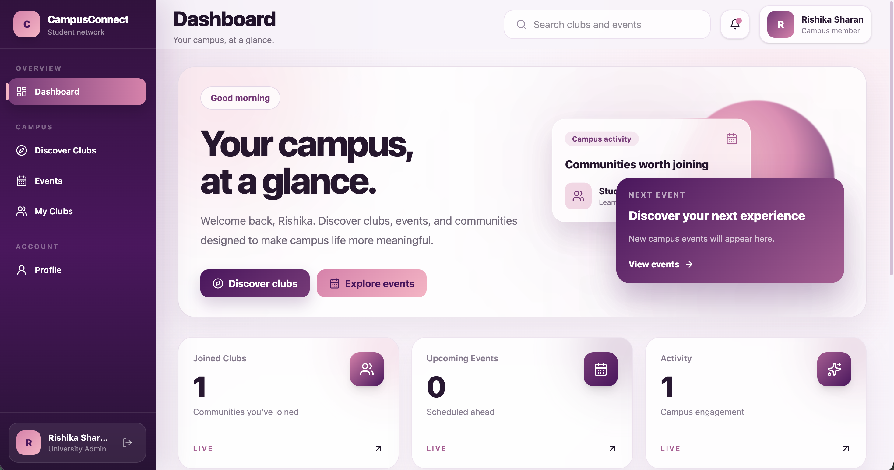
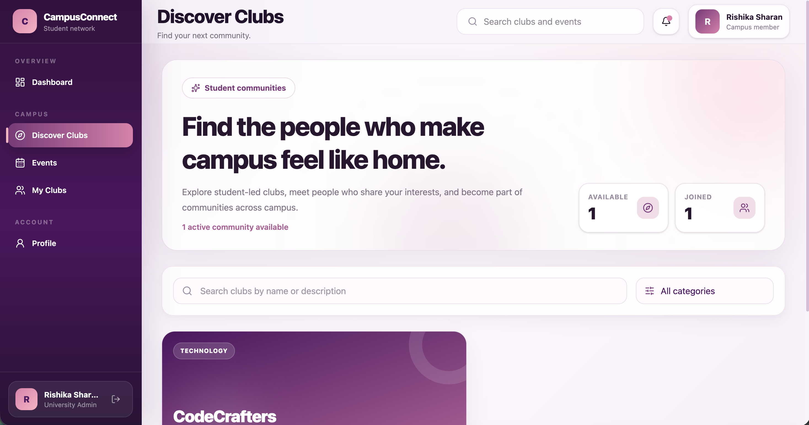
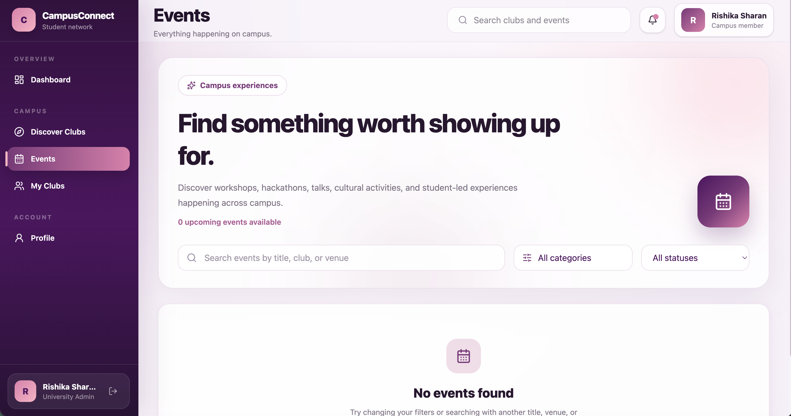
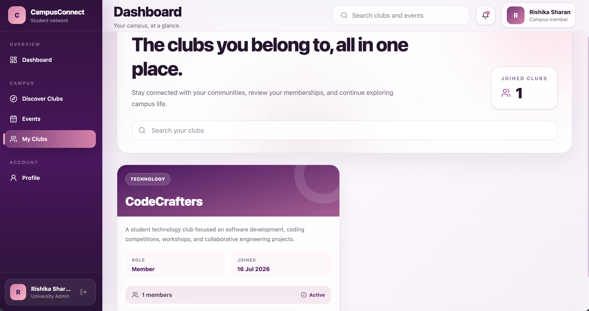
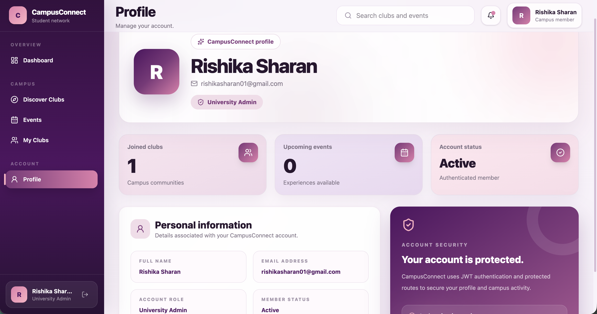

# CampusConnect

A modern full-stack campus community platform that enables students to discover clubs, join communities, explore campus events, and manage their student profile through a secure, responsive, and production-style web application.

---

## ✨ Highlights

- JWT-based Authentication & Authorization
- Secure Protected Routes
- Club Discovery & Membership Management
- Event Discovery with Search & Filters
- Personalized Dashboard
- Student Profile
- Responsive Modern UI
- RESTful API Architecture
- PostgreSQL Persistence

---

# Screenshots

## Dashboard



---

## Clubs



---

## Events



---

## My Clubs



---

## Profile



---

# Tech Stack

## Frontend

- React 19
- Vite
- Tailwind CSS
- React Router DOM
- Axios
- Framer Motion
- Lucide React

## Backend

- Java 21
- Spring Boot 3
- Spring Security
- JWT Authentication
- Spring Data JPA
- Hibernate
- PostgreSQL
- Maven

---

# Features

## Authentication

- Secure Login
- JWT Authentication
- Protected Routes
- Persistent Login Session

---

## Dashboard

- Personalized Welcome Screen
- Club Statistics
- Upcoming Events
- Responsive Cards
- Quick Navigation

---

## Clubs

- Browse Student Clubs
- Search Communities
- Category Filters
- Join Club
- Leave Club
- Membership Status

---

## Events

- Browse Upcoming Events
- Search Events
- Category Filters
- Ticket-style Event Cards
- Event Information
- Empty & Loading States

---

## My Clubs

- View Joined Communities
- Membership Details
- Search Joined Clubs
- Leave Membership

---

## Profile

- Student Information
- Membership Summary
- Upcoming Event Summary
- Account Status

---

# Project Architecture

```
                React + Vite
                      │
                 Axios Client
                      │
                REST API Calls
                      │
             Spring Boot Backend
                      │
        Spring Security + JWT Filter
                      │
             Service Layer
                      │
          Spring Data JPA
                      │
                 PostgreSQL
```

---

# Project Structure

```
CampusConnect
│
├── backend
│   ├── controller
│   ├── service
│   ├── repository
│   ├── entity
│   ├── security
│   └── config
│
├── frontend
│   ├── components
│   ├── layouts
│   ├── pages
│   ├── services
│   ├── context
│   └── assets
│
├── screenshots
│
└── README.md
```

---

# Local Setup

## Clone Repository

```bash
git clone <repository-url>
cd CampusConnect
```

---

## Backend

Set a strong Base64-encoded JWT secret before starting. For local development, copy `.env.example` to `.env` and export the values in your shell (Docker Compose reads `.env` for Postgres only). Generate a secret with `openssl rand -base64 48`. Never commit the generated secret.

```bash
export JWT_SECRET="$(openssl rand -base64 48)"
cd backend
./mvnw spring-boot:run
```

Backend runs on:

```
http://localhost:8080
```

---

## Frontend

```bash
cd frontend
npm install
npm run dev
```

Frontend runs on:

```
http://localhost:5173
```

---

# Environment Variables

## Backend

```
JWT_SECRET=

DB_URL=

DB_USERNAME=

DB_PASSWORD=
CORS_ALLOWED_ORIGINS=http://localhost:5173,http://localhost:5174
```

The backend listens on `PORT` when supplied by the deployment platform, otherwise `SERVER_PORT` or port 8080.

## Frontend

```
VITE_API_BASE_URL=http://localhost:8080/api/v1
```

---

# API Modules

- Authentication
- Clubs
- Club Memberships
- Events
- User Profile

---

# Future Enhancements

- Event Registration
- Club Admin Portal
- Announcement System
- Notifications
- Calendar Integration
- QR Event Check-in
- Admin Dashboard

---

# Author

**Rishika Sharan**

B.Tech Computer Science (Artificial Intelligence)

Indira Gandhi Delhi Technical University for Women (IGDTUW)

GitHub: https://github.com/rishika150

## Interview demo data

The optional Spring profile `demo` seeds **8 fictional clubs and 32 example events** with dates relative to the first run. Run the backend with `SPRING_PROFILES_ACTIVE=demo` and your usual PostgreSQL and JWT environment settings. Seeds skip previously created club/event titles and do **not** represent actual university announcements. The normal profile does not seed any data.

## Admin event CSV import

A university administrator can upload a UTF-8 CSV at `POST /api/v1/admin/import/events/csv` (multipart field `file`) or through the management workspace. Required headers: `externalId,clubId,title,description,venue,startTime,endTime,registrationDeadline,capacity,category`. Optional: `bannerUrl`. All dates must be ISO-8601 UTC instants, e.g. `2026-12-01T10:00:00Z`. The upload is limited to 1 MB and processing is capped at 200 rows. Each row is validated and reports errors. Repeated imports skip rows matching an existing club ID, case-insensitive event title, and exact start timestamp. This is basic deduplication, not yet a concurrency-safe external-ID upsert.


## Google Sheets event sync (no paid API)

University admins can publish an events spreadsheet as CSV and submit the **direct CSV export URL** to the management workspace. The backend accepts only HTTPS links at `docs.google.com/spreadsheets/d/...`, with redirects disabled, a 12-second request timeout, and a 1 MB response limit. The sheet must be publicly readable; private spreadsheets are not supported.

The CSV now requires `externalId` plus `clubId,title,description,venue,startTime,endTime,registrationDeadline,capacity,category`. Optional: `bannerUrl`. Use a permanent `externalId` per event and a consistent **source name** per spreadsheet, for example `university-events`. Repeated imports skip unchanged events and update changed event details without creating a second row. The same behavior is available for uploaded CSVs with a source name.

Sync endpoint: `POST /api/v1/admin/import/events/google-sheet`, JSON: `{"url":"https://docs.google.com/spreadsheets/d/.../export?format=csv","source":"university-events"}`. Only university admins can call it. Sync runs **on demand**; there is no background schedule yet. Changes to event dates must satisfy normal backend validation, and cancelled events are not resurrected. This path is intended for reviewed public data, not sensitive student information.
